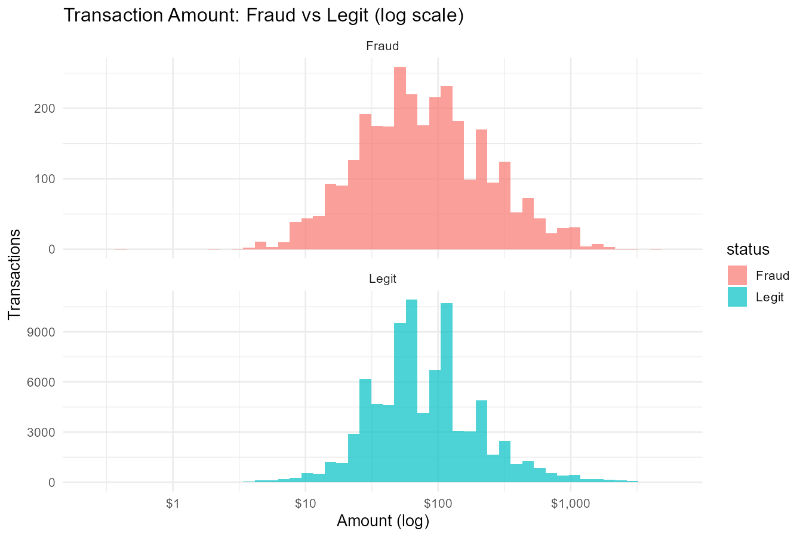
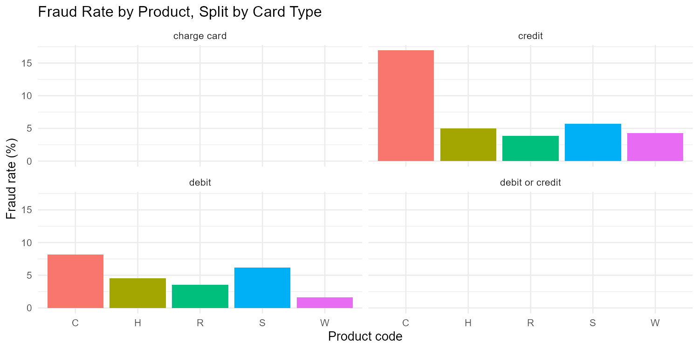

# Card Transaction Fraud Detection (Exploratory Analysis)

## Business Task
The goal is to find clear, interpretable patterns of high fraud risk in card transaction data. The analysis looks across product type, card type, transaction amount, email domain, device, and time of day, so the Risk team can refine its automated fraud detection rules. The priority is to balance security with customer experience: catch fraud while keeping false declines of legitimate customers low. This work is an exploratory data analysis that comes before any predictive model.

## Data
IEEE-CIS Fraud Detection (Vesta, via Kaggle). 590,540 transactions, with about a 3.5% fraud rate. The data is anonymized and from 2019. License: competition terms.

## Tools
BigQuery for SQL aggregation and window functions, R with ggplot2 for the charts, and Tableau Public for the dashboard.

BigQuery was chosen over spreadsheets because the dataset is roughly 254M cells, which is well above the 10M cell limit in Google Sheets.

## Process
The transaction and identity tables were joined with a LEFT JOIN on TransactionID. Hour of day was derived from TransactionDT, and transaction amounts were grouped into bands with CASE WHEN. The full cleaning step is in `cleaning.sql`, and the aggregation queries that produce each CSV are in `analysis.sql`. Charts were then built in R from those aggregates (`analysis.R`).

## Key Findings

### 1. Transaction amount on its own is a weak signal, and the middle band carries the most risk
The 250 to 1,000 dollar band has the highest fraud rate at 5.41%, while the 1,000 dollar and above band is surprisingly low at 2.47%. A large amount by itself does not mean a transaction is risky.



### 2. Fraud concentrates in a short window in the early morning
Fraud rate is lowest in the early afternoon at around 2.3% and rises through the early morning, reaching 10.61% at 7 AM, which is roughly three times the daytime level. The hour by day heatmap shows the 7 to 8 AM cells running as high as 13 to 14%. This window holds only about 4% of the daily transaction volume.


### 3. Product type C, especially on credit cards, drives far more fraud than its size suggests
Product C is only 11.6% of all transactions but accounts for 38.8% of all fraud, at an 11.69% fraud rate, more than five times the 3.50% baseline. The credit card portion of Product C is the single riskiest segment at 16.92%. Product W is the opposite case: 74.5% of the volume but a low 2.04% rate.



## Recommendations

1. Add extra verification on the riskiest profiles. Apply a stronger check such as 3-D Secure or a one time passcode when several risk signals appear together: Product C (especially on credit cards), mobile sessions (10.17% versus 2.10% for unknown device traffic), and high risk email domains (mail.com at 18.96%, outlook.com at 9.46%). Layering the signals targets the riskiest cases without adding friction for most customers.

2. Run focused human review during the 5 to 9 AM peak, with priority on 7 to 8 AM. This window is only about 4% of daily volume but carries three to five times the fraud rate, so a small and well timed review effort catches a large share of fraud.

3. Tune the amount threshold to balance detection against false declines. Concentrate scrutiny on the 250 to 1,000 dollar band, which is the riskiest at 5.41%, rather than blocking all high value transactions. The 1,000 dollar and above band is low risk at 2.47%, so blocking it would mostly reject legitimate customers.

## Dashboard
🔗 [Tableau Public, Fraud Detection Dashboard](https://public.tableau.com/app/profile/abdulrashid.mustafa/viz/Fraud_Detection_Dashboard_17810525393330/Dashboard1)

## Note on Scope
This is an exploratory analysis that comes before any model. It identifies interpretable risk factors to guide detection rules. A later phase could add geolocation, account age and tenure, and session behavior to support a supervised predictive model.

## Repository Structure
```
card-fraud-eda/
  README.md
  cleaning.sql            BigQuery: join and derive the clean table
  analysis.sql            BigQuery: aggregation queries
  analysis.R              R and ggplot2: builds the three charts
  chart_amount_hist.png
  chart_heatmap.png
  chart_facet.png
  fraud_by_product.csv    aggregated CSV outputs
  fraud_by_card.csv
  fraud_by_amount.csv
  by_hour.csv
  fraud_by_device.csv
  fraud_by_email.csv
  by_product_card.csv
  heatmap.csv
  amount_sample.csv
```
