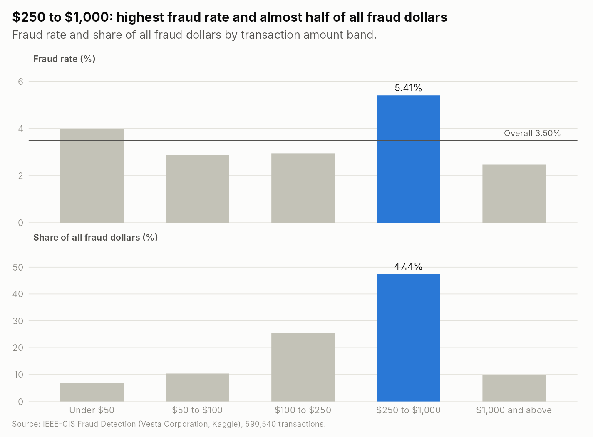
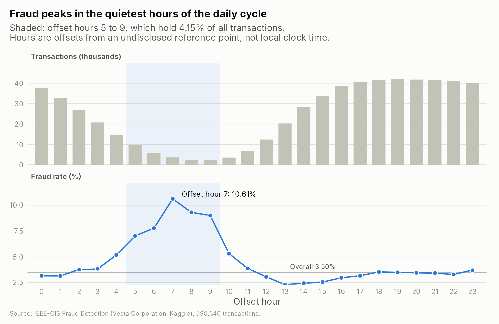
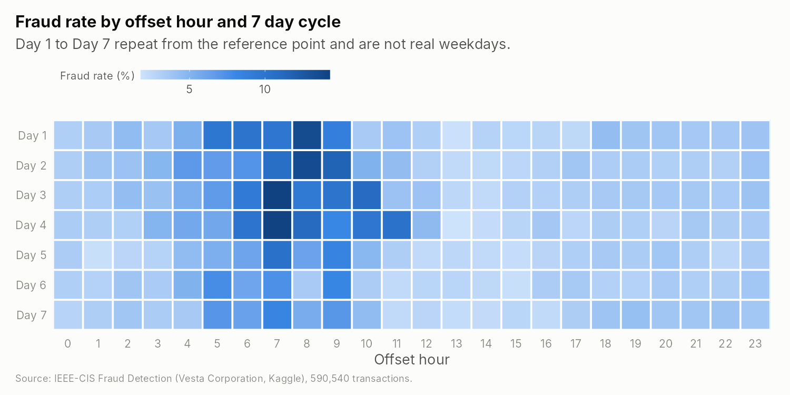
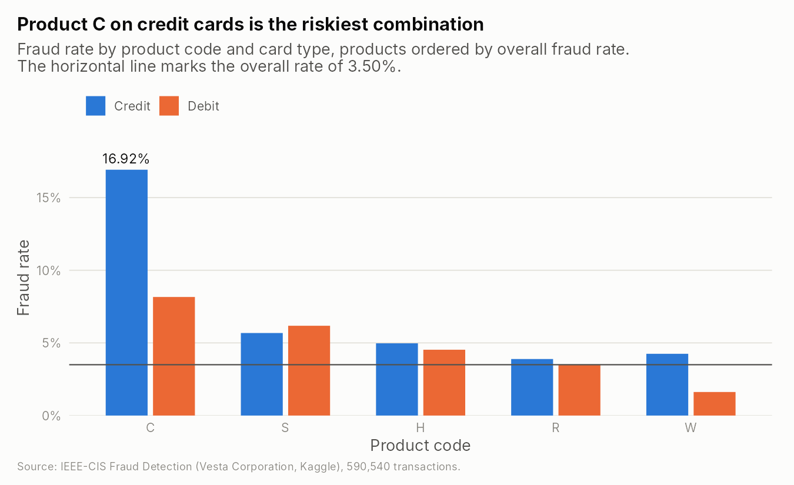

# Card Transaction Fraud Detection (Exploratory Analysis)

## Business Task
The goal is to find clear, interpretable patterns of high fraud risk in card transaction data. The analysis looks across product type, card type, transaction amount, email domain, device, and relative hour of day, so the Risk team can refine its automated fraud detection rules. The priority is to balance security with customer experience: catch fraud while keeping false declines of legitimate customers low. This work is an exploratory data analysis that comes before any predictive model.

## Data
IEEE-CIS Fraud Detection, provided by Vesta Corporation through a Kaggle competition released in 2019 ([competition page](https://www.kaggle.com/competitions/ieee-fraud-detection)). The training set has 590,540 online card transactions, of which 20,663 are fraud (3.50%), worth $3.08 million out of $79.74 million in total spend. The features are anonymized and the actual transaction dates are not disclosed: TransactionDT is a time offset in seconds from an undisclosed reference point, not a real timestamp, so every hour and day value in this project is relative. Use of the data is governed by the competition rules.

## Tools
BigQuery for SQL aggregation and window functions, R with ggplot2 for the charts, and Tableau Public for the dashboard. DuckDB was used to rerun the same SQL locally as an independent check.

BigQuery was chosen over spreadsheets because the transaction table alone holds about 233 million cells (590,540 rows by 394 columns), far above the 10 million cell limit in Google Sheets.

## Process
The transaction and identity tables were joined with a LEFT JOIN on TransactionID. A relative hour (0 to 23) and a day index were derived from TransactionDT, and transaction amounts were grouped into bands with CASE WHEN. The cleaning step is in `cleaning.sql`, and the validation and aggregation queries that produce each CSV are in `analysis.sql`. Charts were then built in R from those aggregates (`analysis.R`).

Validation (`validation_checks.csv`): the join kept exactly one row per transaction (590,540 rows, all TransactionIDs unique), amounts are never missing and range from $0.25 to $31,937, and the data covers 182 relative days. Card type is missing for 1,571 transactions, purchaser email domain for 94,456, and device type for 449,730. The queries were also run in DuckDB on the original Kaggle files, and every result that also existed in the first version matches the BigQuery export exactly.

## Key Findings

### 1. The $250 to $1,000 band has the highest fraud rate and almost half of all fraud dollars
The $250 to $1,000 band has the highest fraud rate at 5.41%, while the $1,000 and above band is surprisingly low at 2.47%, so a large amount by itself does not make a transaction risky. Measured in dollars the picture is sharper: the $250 to $1,000 band holds 15.4% of fraud cases but 47.4% of all fraud dollars ($1.46 million of $3.08 million).



### 2. Fraud concentrates in the quietest hours of the daily cycle
Because TransactionDT is relative, the hours below are offset hours, not local clock time. The fraud rate is lowest at offset hour 13 (2.29%) and peaks at offset hour 7 (10.61%), about three times the 3.50% overall rate. The peak falls exactly where volume is lowest: offset hours 5 to 9 carry only 4.15% of all transactions but 9.71% of all fraud cases. This pattern is consistent with overnight activity, when fewer genuine customers are shopping. In the heatmap, single cells at offset hours 7 and 8 reach 13 to 14%, although each of those cells holds fewer than 500 transactions.





### 3. Product type C, especially on credit cards, drives far more fraud than its size suggests
Product C is only 11.6% of all transactions but accounts for 38.8% of all fraud cases, at an 11.69% fraud rate, 3.34 times the 3.50% baseline. The credit card portion of Product C is the riskiest product and card type combination at 16.92%. Product W is the opposite case on rate, with 74.5% of the volume at a low 2.04%, yet it still holds the largest number of fraud cases (43.4% of all fraud), so a low rate does not mean low exposure.



## Rule Scorecard
Each candidate rule from the findings was scored on the full data (`rule_scorecard.csv`): the share of transactions it would flag, the share of flagged transactions that are fraud (precision), and the share of all fraud cases and fraud dollars it catches (recall).

| Candidate rule | Flagged | Precision | Fraud cases caught | Fraud dollars caught |
|---|---|---|---|---|
| Product C on credit card | 4.67% | 16.92% | 22.57% | 7.69% |
| Two or more of: Product C, mobile, risky email | 5.17% | 13.56% | 20.03% | 6.33% |
| Product C | 11.60% | 11.69% | 38.76% | 12.69% |
| Email mail.com or outlook.com | 0.96% | 10.40% | 2.85% | 2.39% |
| Mobile device | 9.42% | 10.17% | 27.38% | 17.72% |
| Offset hours 5 to 9 | 4.15% | 8.19% | 9.71% | 8.32% |
| Amount $250 to $1,000 | 9.95% | 5.41% | 15.39% | 47.38% |

Three points stand out. Product C on credit cards has the best precision of any rule, but fraud in Product C involves small amounts, so it catches only 7.69% of fraud dollars. The $250 to $1,000 band is the opposite: low precision, yet it covers 47.38% of fraud dollars. And the layered rule that needs two or more signals does worse than the Product C credit rule alone on both precision and coverage, so adding signals does not automatically make a rule better.

## Recommendations

1. Use Product C on credit cards as the main trigger for step up verification, such as 3-D Secure or a one time passcode. It flags 4.67% of transactions, about one in six of them is fraud (16.92%), and it catches 22.57% of all fraud cases. Device and email signals work better as supporting review flags than as extra layers: device data does not exist for Product W, and the layered rule above does worse than this single rule. Within each product, mobile traffic is still riskier than desktop, most clearly in Product R (7.47% versus 2.23%) and Product S (11.62% versus 4.44%).

2. Add focused manual review in the low volume window, offset hours 5 to 9, with priority on offset hours 7 and 8. The window holds 4.15% of transactions, about 135 a day, but 9.71% of fraud cases, a fraud rate of 8.19%, or 2.34 times the overall rate. It is an efficient targeted control that catches about one fraud case in ten, not a complete solution, and the offset hours must be mapped to local time with real timestamps before any staffing decision.

3. Protect the dollars with an amount based control. A step up check or review queue on the $250 to $1,000 band covers 47.38% of all fraud dollars while flagging 9.95% of transactions, far more money than the Product C rule protects. The $1,000 and above band does not justify a blanket block: its fraud rate is low at 2.47%, so blocking it would mostly reject legitimate customers, yet it holds 10.0% of fraud dollars, so a light manual review of these 7,580 transactions is the proportionate response.

## Dashboard
🔗 [Tableau Public, Fraud Detection Dashboard](https://public.tableau.com/app/profile/abdulrashid.mustafa/viz/Fraud_Detection_Dashboard_17810525393330/Dashboard1)

## Scope and Limitations
This is an exploratory analysis that comes before any model. It identifies interpretable risk factors to guide detection rules. A later phase could add geolocation, account age and tenure, and session behavior to support a supervised predictive model.

* Time fields are relative to an undisclosed reference point, so hour and day patterns cannot be read as local clock time or real weekdays.
* Rates are measured one or two variables at a time, and signals such as product and device overlap, so their effects are not independent.
* The rule scorecard is measured on the same data used to find the patterns, so its precision and coverage will be optimistic for new transactions.
* Fraud labels follow Vesta's own definition, explained in the [competition data discussion](https://www.kaggle.com/c/ieee-fraud-detection/discussion/101203).

## AI Assistance
Claude (Anthropic) was used as a review partner to audit the analysis, rerun the queries locally in DuckDB, and help revise the SQL, the R charts and this README. All analysis figures in this README are taken or calculated from the CSV outputs in this repository.

## Repository Structure
```
card-fraud-eda/
  README.md
  cleaning.sql              BigQuery: join and derive the clean table
  analysis.sql              BigQuery: validation and aggregation queries
  analysis.R                R and ggplot2: builds the four charts
  chart_amount_bands.png
  chart_hourly.png
  chart_heatmap.png
  chart_product_card.png
  validation_checks.csv     row counts, uniqueness and missing values
  overall_kpis.csv          overall fraud rate and fraud amount
  rule_scorecard.csv        precision and coverage of candidate rules
  hour_windows.csv          volume and fraud share of the offset hour windows
  fraud_by_product.csv      aggregated outputs
  fraud_by_card.csv
  fraud_by_amount.csv
  fraud_by_amount_usd.csv
  by_hour.csv
  heatmap.csv
  fraud_by_device.csv
  product_by_device.csv
  fraud_by_email.csv
  by_product_card.csv
```
